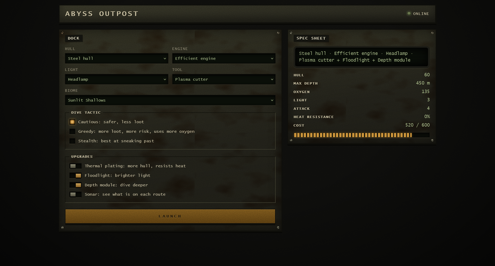
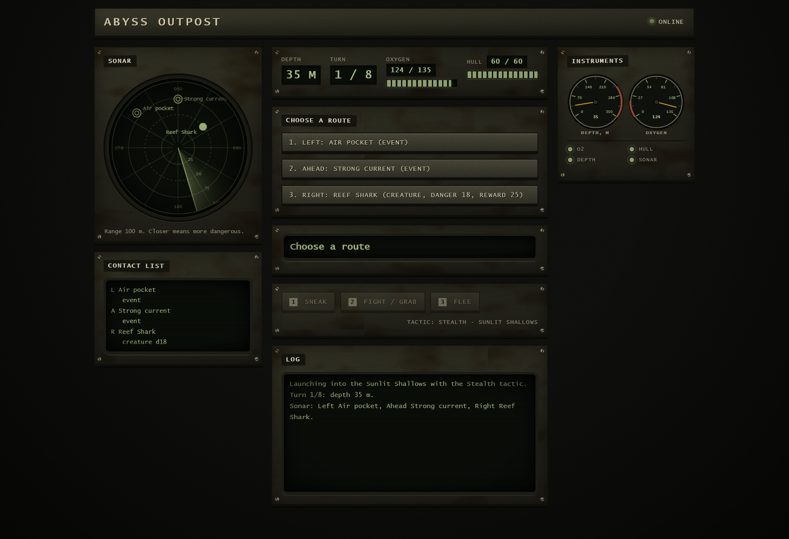
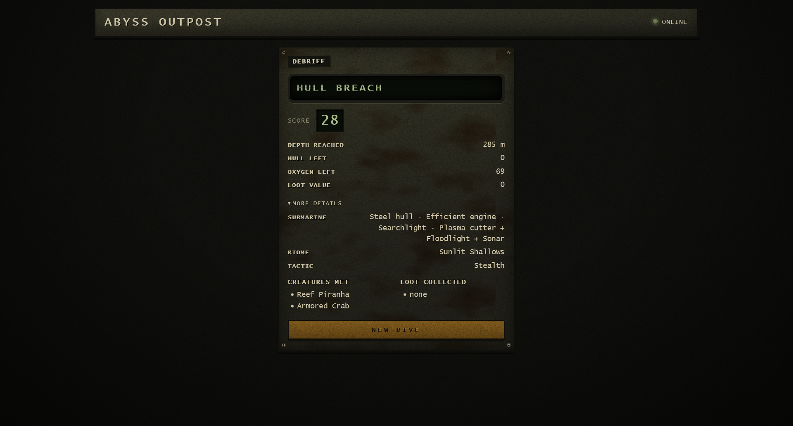
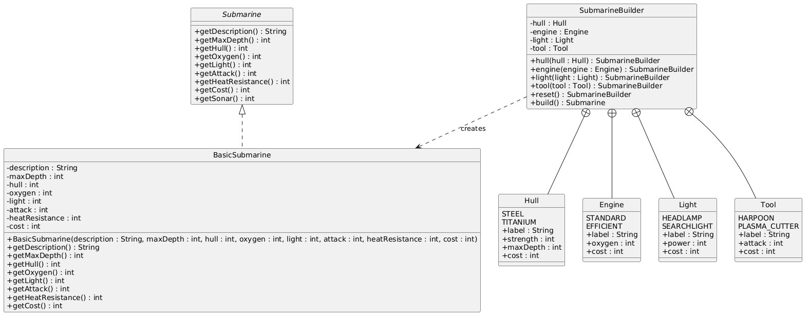
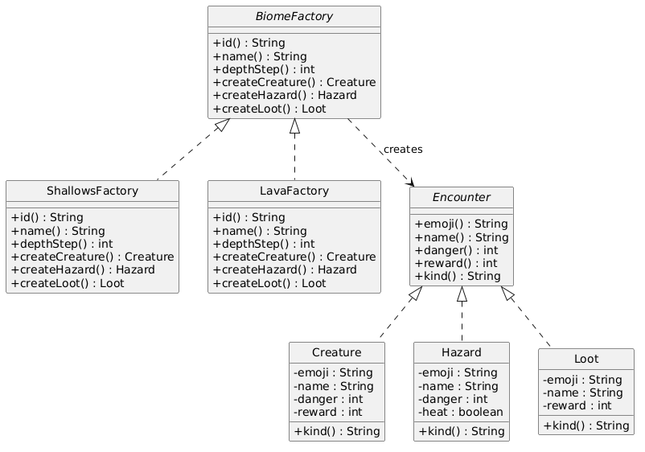
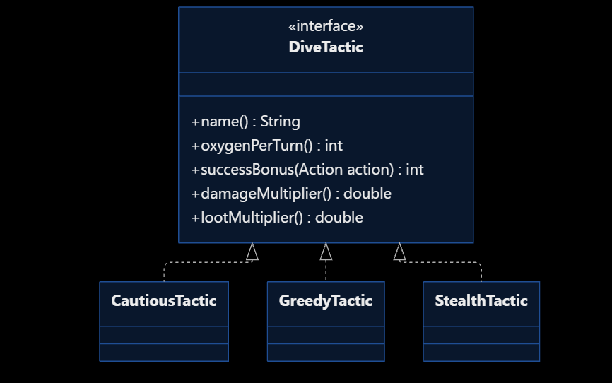
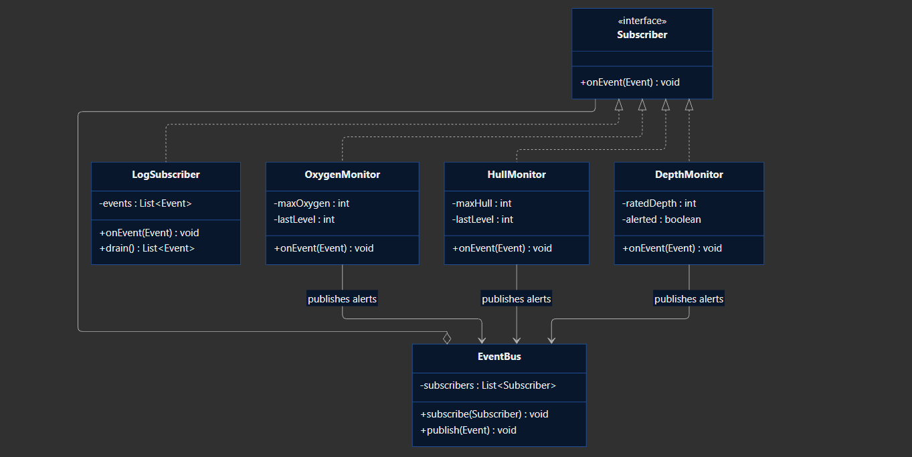
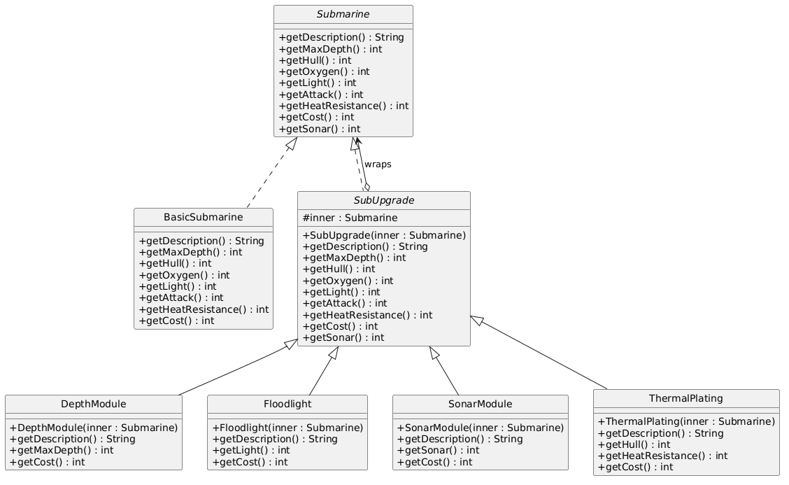
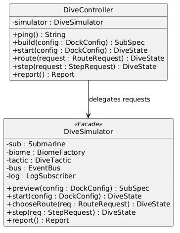
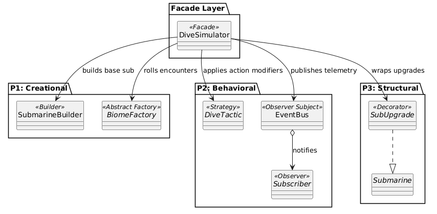

# Abyss Outpost

Course: Software Design Patterns (SE-2540)

Team Members:

- Sergey Kim (P1)
- Nurkhan Karashev (P2)
- Tilekkali Nurtore (P3)

## Project Overview

Abyss Outpost is a turn-based submarine exploration game written in Java using Spring Boot with a web-based CRT dashboard. Players configure a submarine under a budget, pick dive tactics, explore underwater biomes, and manage hull and oxygen levels over an 8-turn dive.

The system integrates 6 GoF design patterns into a single game loop.

## Application Screenshots

### Screen 1: Submarine Dock

Submarine configuration, component selection, tactic choice, and budget calculations.

### Screen 2: Dive HUD

Live dive screen showing depth, oxygen, hull status, sonar sweep, action buttons, and monitor log alerts.

### Screen 3: Debrief

Mission outcome, final score, resource report, and log of encountered creatures and items.

## Pattern Distribution

| Member                 | Pattern          | Category   | Key Classes                                             |
| :--------------------- | :--------------- | :--------- | :------------------------------------------------------ |
| Sergey Kim (P1)        | Builder          | Creational | SubmarineBuilder, BasicSubmarine                        |
| Sergey Kim (P1)        | Abstract Factory | Creational | BiomeFactory, ShallowsFactory, LavaFactory              |
| Nurkhan Karashev (P2)  | Strategy         | Behavioral | DiveTactic, CautiousTactic, GreedyTactic, StealthTactic |
| Nurkhan Karashev (P2)  | Observer         | Behavioral | EventBus, OxygenMonitor, HullMonitor, DepthMonitor      |
| Tilekkali Nurtore (P3) | Decorator        | Structural | SubUpgrade, DepthModule, SonarModule, ThermalPlating    |
| Tilekkali Nurtore (P3) | Facade           | Structural | DiveSimulator, DiveController                           |

## Pattern Details and UML Diagrams

### 1. Builder Pattern (Sergey Kim - P1)

`SubmarineBuilder` builds `BasicSubmarine` objects from component parts (Hull, Engine, Light, Tool). It checks for null values, calculates stats (max depth, hull, oxygen, attack), and sums the total component cost.

### 2. Abstract Factory Pattern (Sergey Kim - P1)

`BiomeFactory` creates families of biome encounters (Creature, Hazard, Loot). `ShallowsFactory` generates shallow reef encounters, while `LavaFactory` generates volcanic deep-sea encounters.

### 3. Strategy Pattern (Nurkhan Karashev - P2)

`DiveTactic` defines interchangeable player tactics. `CautiousTactic` saves oxygen, `GreedyTactic` increases loot and risks, and `StealthTactic` boosts sneak chances.

### 4. Observer Pattern (Nurkhan Karashev - P2)

`EventBus` receives telemetry events (OXYGEN, HULL, DEPTH). Monitors trigger warnings when thresholds are crossed (oxygen <= 30%, hull <= 40%, or depth > max depth) and pass them to `LogSubscriber`.

### 5. Decorator Pattern (Tilekkali Nurtore - P3)

`SubUpgrade` wraps a `Submarine` instance to stack stats dynamically. Modules include `ThermalPlating` (hull/heat defense), `DepthModule` (max depth), `Floodlight` (visibility), and `SonarModule` (route scouting).

### 6. Facade Pattern (Tilekkali Nurtore - P3)

`DiveSimulator` provides a single entry point for the REST controller. It manages vessel creation, turn progression, tactical action checks, vital monitoring, and final score reporting.

## System Architecture

The integrated diagram shows how `DiveSimulator` coordinates all 6 patterns:

## Verification and Testing

### Unit Tests

- `SubmarineBuilderTest`: Tests default configurations, custom stats, cost calculation, reset, and null validation.
- `BiomeFactoryTest`: Tests encounter generation and attributes for Shallows and Lava factories.
- `AbyssOutpostApplicationTests`: Verifies Spring application context loading.

### Demo Scripts

- `P1Demo.java`: Tests SubmarineBuilder configurations and BiomeFactory encounter rolls.
- `P2Demo.java`: Tests EventBus notifications, staged monitor alerts, and tactic values.
- `P3Demo.java`: Tests Decorator module stacking on a base submarine.
- `P3Benchmark.java`: Runs 2,000 automated dives to evaluate survival rates and tactics.

## How to Run

### Start Application

On Linux / macOS:
./mvnw spring-boot:run

On Windows:
.\mvnw.cmd spring-boot:run

Open in browser: http://localhost:8080

### Run Tests

./mvnw test

## Conclusion and Future Work

- Results: The project separates vessel building, biome creation, dive tactics, telemetry alerts, and upgrades into distinct, decoupled components using standard design patterns.
- Future Work: Adding a database for saving player scores, supporting multiple concurrent sessions, and adding new biomes.
